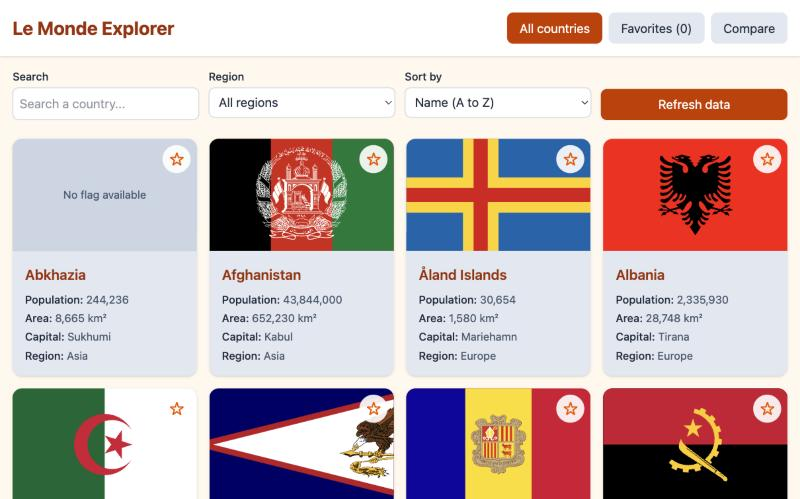
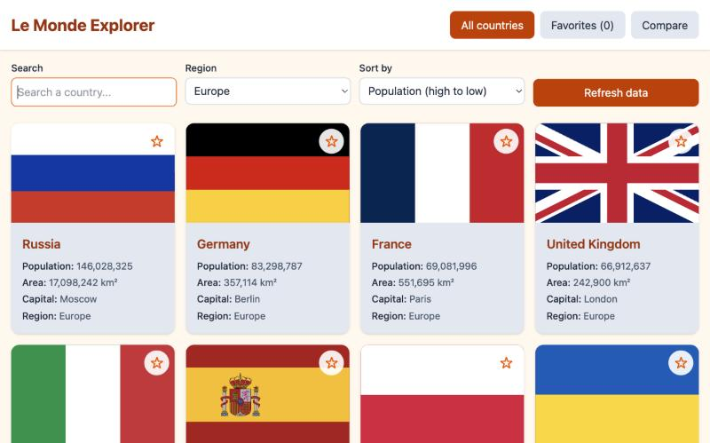
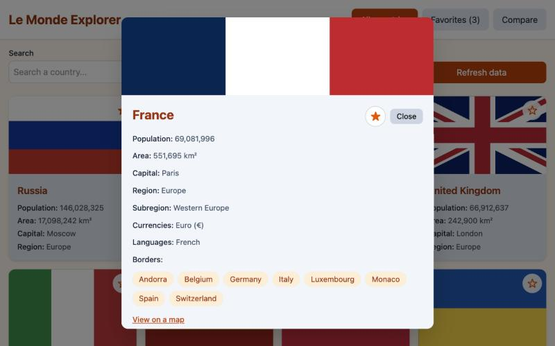
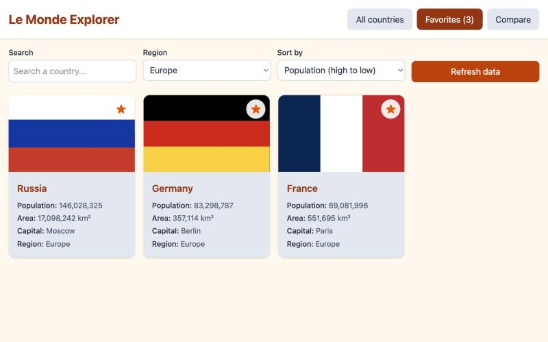
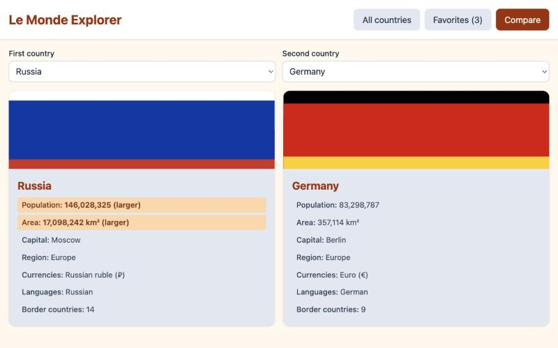
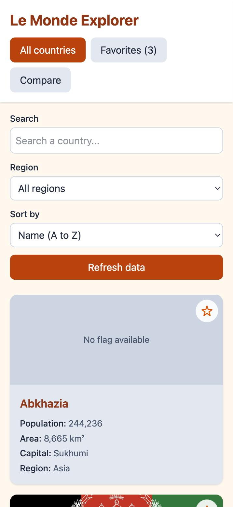

# Le Monde Explorer

A small app to discover the countries of the world. You can search, filter by region, sort, open a country to see its details, save your favourites and compare two of them side by side.

This is my Milestone 2 project (JavaScript Mastery) for the WSCube Tech Full Stack Mentorship. It is made with plain JavaScript only, with no frameworks and no libraries.

- **Name:** Vanjul Thakur
- **Batch:** May 2026
- **Option:** C, World Explorer

## Links

- Live site: https://le-monde-explorer.vercel.app
- Code: https://github.com/vanjulT/le-monde-explorer

## How to open it

**Easiest:** open the live site above. Nothing to install.

**From the zip or a copy of the code:** do not double-click `index.html`. Browsers block JavaScript modules opened straight from a file, so the page stays empty. Start a small local server instead:

1. Open a terminal in the `le-monde-explorer` folder.
2. Run `npx serve` (it needs Node.js).
3. Open the address it shows, usually http://localhost:3000.

## What it does

- Shows all 254 countries as cards with the flag, population, area, capital and region.
- Search by country name. The search waits until you stop typing (debounce), so the page does not redraw after every key.
- Filter by region (the region list is built from the real data) and sort by name, population or area.
- Click a country to open a pop-up with currencies, languages, the neighbours and a link to a map.
- The neighbours are clickable. Click one and the pop-up jumps to that country.
- Star a country to save it. Your favourites are kept in LocalStorage, so they are still there after a refresh.
- The Compare view puts two favourites side by side and marks the bigger population and area.
- Loading, error and empty messages, so the page always tells you what is happening.

## The API

I use the [REST Countries](https://restcountries.com) API (version 5). The older versions are switched off, and the new one needs an API key, so I made a free one. The key is limited to my own sites (localhost and my Vercel address), which is why it is safe to have it in the code of a front-end project. The API gives at most 100 countries per request, so the app asks three times (offset 0, 100 and 200) and joins the results.

## Screenshots

### Home



### Filter and sort (Europe, biggest population first)



### Country details



### Favourites



### Compare two countries



### On a phone



## How the code is organised

| File | Job |
| --- | --- |
| `index.html` | The page: header, filters, grid, compare area and the pop-up |
| `js/config.js` | The API address and the key |
| `js/api.js` | Fetches all the countries, page by page, with `async/await` |
| `js/storage.js` | Reads and saves the favourites in LocalStorage |
| `js/app.js` | Builds the cards, handles search, filter, sort, favourites, compare and the pop-up |

## Things I used

- `fetch` with `async/await` and `try/catch` on the API calls
- `filter`, `map`, `sort` and `find` to search, filter and sort the list
- Event delegation: one click listener on the grid, and one on the pop-up
- A DocumentFragment, so 254 cards are added to the page in one go
- Tailwind CSS v4 for the styling

## Run it yourself

You do not need an API key to try it. The app first asks the live API. If the API does not answer (for example the key does not allow your address, or the free limit is reached), it uses a saved copy of the data in `data/countries-backup.json` and shows a small yellow note.

```
git clone https://github.com/vanjulT/le-monde-explorer.git
cd le-monde-explorer
npm install
npm run build
npx serve
```

Then open the address `npx serve` shows. While you change the styles, `npm run dev` rebuilds the CSS every time you save.

To use live data on your own computer, make a free key at restcountries.com, allow your address (for example `localhost`) in the key settings, and put it in `js/config.js`.

## Troubleshooting

| What you see | Why | What to do |
| --- | --- | --- |
| A white page with no countries after double-clicking `index.html`. The browser console says: `Access to script at 'file:///…/js/app.js' from origin 'null' has been blocked by CORS policy` | Browsers block JavaScript modules opened straight from a file (`file://`) | Do not double-click. Run `npx serve` in the folder and open the address it shows (see [How to open it](#how-to-open-it)) |
| A yellow note: "The live country service is not answering right now, so you are seeing a saved copy…" | The API refused the request. The console shows `403` and `Origin is not allowed for this API key` (the key only allows my own addresses), or the free limit is reached, or the API is down | Nothing: the app works with the saved copy. Click **Refresh data** later to try the live data again |
| A red box: "Could not load the countries. Failed to fetch", with a **Try again** button | No internet connection (or DevTools set to Offline), so neither the API nor the saved copy can load | Check the connection, then click **Try again** |
| A red box: "Could not load the countries. The server answered with status …" | The API answered with an error and the saved copy could not be loaded either | Make sure the `data` folder is there, then click **Try again** |
| The page works but has no colours or layout | `css/output.css` is missing: it is built by Tailwind and not stored on GitHub | Run `npm install` and `npm run build`, then reload |
| A Vercel login page instead of the app | The link is a private Vercel preview link (it contains `-git-` or random letters) | Use the main link: https://le-monde-explorer.vercel.app |
| `npx serve` says `command not found` | Node.js is not installed | Install Node.js from nodejs.org, then run `npx serve` again |

## How I worked

Each part has its own branch and pull request: layout, fetching the countries, search and filters, the detail pop-up, favourites, compare and polish.