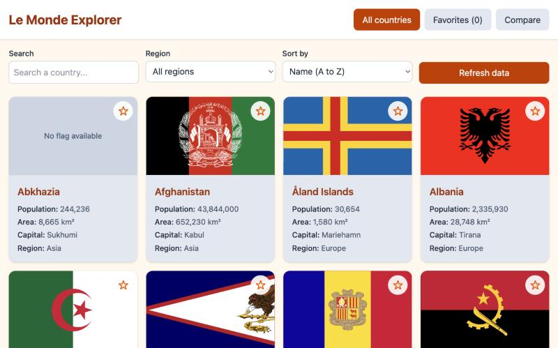
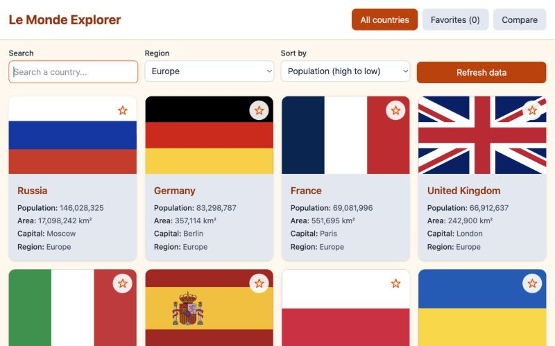
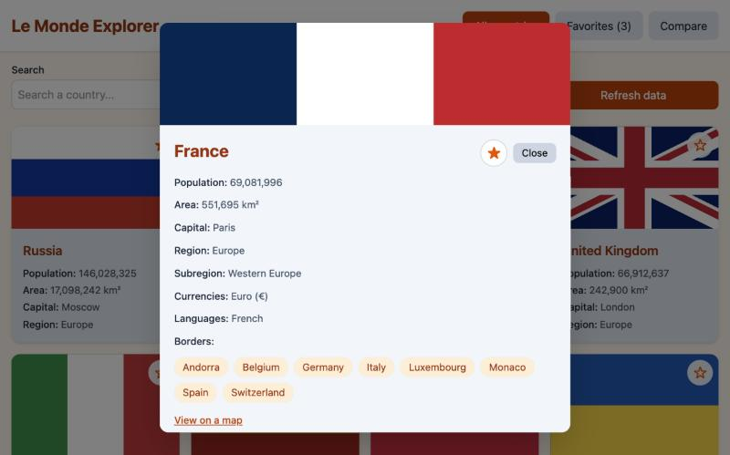
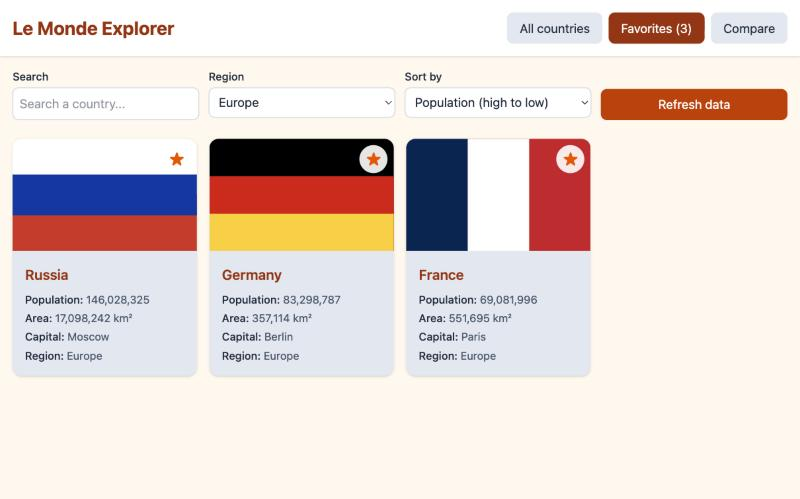
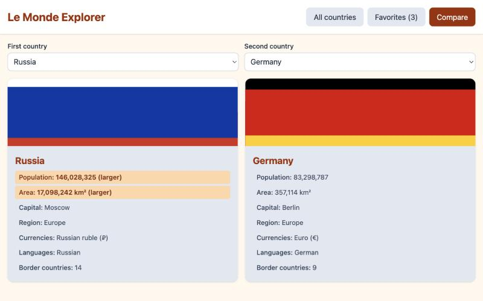
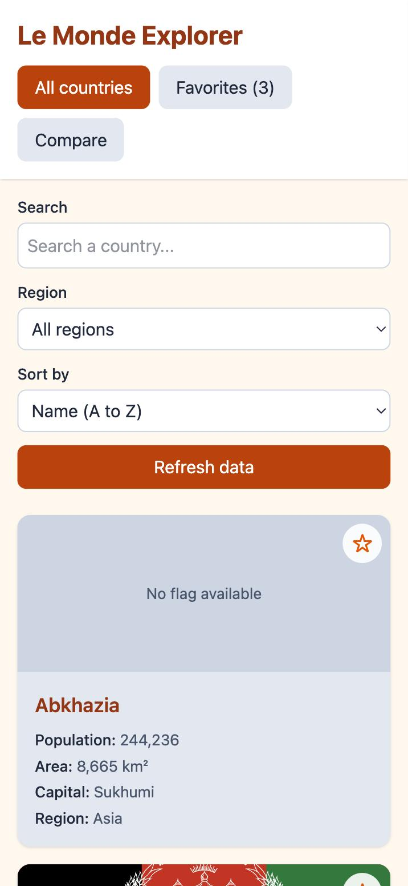

# Le Monde Explorer

A small app to discover the countries of the world. You can search, filter by region, sort, open a country to see its details, save your favourites and compare two of them side by side.

This is my Milestone 2 project (JavaScript Mastery) for the WSCube Tech Full Stack Mentorship. It is made with plain JavaScript only, with no frameworks and no libraries.

- **Name:** Vanjul Thakur
- **Batch:** May 2026
- **Option:** C, World Explorer

## Links

- Live site: [add the Vercel link here]
- Code: https://github.com/vanjulT/le-monde-explorer

## What it does

- Shows all 254 countries as cards with the flag, population, area, capital and region.
- Search by country name. The search waits until you stop typing (debounce), so the page does not redraw after every key.
- Filter by region (the region list is built from the real data) and sort by name, population or area.
- Click a country to open a pop-up with currencies, languages, the neighbours and a link to a map.
- The neighbours are clickable. Click one and the pop-up jumps to that country.
- Star a country to save it. Your favourites are kept in LocalStorage, so they are still there after a refresh.
- The Compare view puts two favourites side by side and marks the bigger population and area.
- Loading, error and empty messages, so the page always tells you what is happening.

## The API

I use the [REST Countries](https://restcountries.com) API (version 5). The older versions are switched off, and the new one needs an API key, so I made a free one. The key is limited to my own sites (localhost and my Vercel address), which is why it is safe to have it in the code of a front-end project. The API gives at most 100 countries per request, so the app asks three times (offset 0, 100 and 200) and joins the results.

## Screenshots

### Home



### Filter and sort (Europe, biggest population first)



### Country details



### Favourites



### Compare two countries



### On a phone



## How the code is organised

| File | Job |
| --- | --- |
| `index.html` | The page: header, filters, grid, compare area and the pop-up |
| `js/config.js` | The API address and the key |
| `js/api.js` | Fetches all the countries, page by page, with `async/await` |
| `js/storage.js` | Reads and saves the favourites in LocalStorage |
| `js/app.js` | Builds the cards, handles search, filter, sort, favourites, compare and the pop-up |

## Things I used

- `fetch` with `async/await` and `try/catch` on the API calls
- `filter`, `map`, `sort` and `find` to search, filter and sort the list
- Event delegation: one click listener on the grid, and one on the pop-up
- A DocumentFragment, so 254 cards are added to the page in one go
- Tailwind CSS v4 for the styling

## Run it yourself

You need your own free key from restcountries.com. Add it in `js/config.js` and allow `localhost` in the key settings.

```
git clone https://github.com/vanjulT/le-monde-explorer.git
cd le-monde-explorer
npm install
npm run dev
```

In a second terminal tab, run `npx serve` and open the address it shows.

## How I worked

Each part has its own branch and pull request: layout, fetching the countries, search and filters, the detail pop-up, favourites, compare and polish.